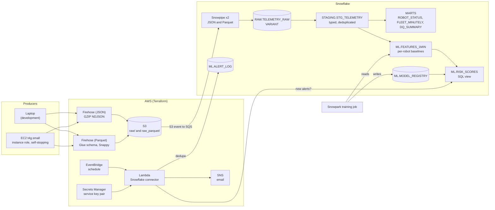

# FleetPulse


An end-to-end data engineering project on robotics telemetry: a Python fleet simulator streams into AWS, lands in Snowflake, and powers fleet analytics, silent-robot detection, a predictive-maintenance model that scores in plain SQL, and an email alert path for robots about to fail.

Built to show the full path a robotics company's data takes, with **no hardware**: a configurable simulator stands in for a warehouse AMR fleet, and everything downstream is real cloud infrastructure defined as code.

## Architecture




| Layer         | What it does                                                                                                                                                                                                                                                                                                   |
| --------------- | ---------------------------------------------------------------------------------------------------------------------------------------------------------------------------------------------------------------------------------------------------------------------------------------------------------------- |
| **Python**    | Simulates robots (battery, motor current and temperature, wear, faults). Three fleet behaviors: all publishing; a percentage split of continuous / random / abrupt-stop robots; random on/off. Fleet size, parameters and behavior can change at runtime through a controller API. Runs on a laptop or on EC2. |
| **AWS**       | Two Firehose streams (GZIP JSON and Parquet via a Glue schema) write to S3, partitioned by date and hour. EventBridge triggers a Lambda that checks Snowflake for newly at-risk robots and emails an SNS topic. IAM, bucket policy, lifecycle, logging, Glue, Lambda, EC2 and the schedule are all Terraform.  |
| **Snowflake** | Snowpipe loads raw records. Dynamic tables type and deduplicate them, build fleet marts, detect silent robots and compute ML features. A resource monitor caps credits.                                                                                                                                        |
| **ML**        | Logistic regression trained with Snowpark, registered in a table, and scored by a SQL view (no Python runtime needed at query time).                                                                                                                                                                           |
| **Alerting**  | Key-pair service user, credentials in Secrets Manager, a log table so each robot is announced once, at-least-once delivery.                                                                                                                                                                                    |

## Results

Dataset: about 1.6 million records across 9 simulator runs: six 2-hour runs of 30 robots (27 robots wear out and trip an overtemp fault), a 10-minute mixed-fleet run, and two Parquet-path runs (one from EC2).


| Check                             | Result                                                                                                                                   |
| ----------------------------------- | ------------------------------------------------------------------------------------------------------------------------------------------ |
| Ingestion                         | 0 dropped records and 0 retries in every run; records sent equal records published                                                       |
| Silent-robot detection            | Mixed-fleet run of 20 robots: the 2 abrupt-stop robots were flagged, silent for 458 and 513 event-seconds                                |
| Failure warning (in Snowflake)    | 27 of 27 failing robots alerted before the fault, **12 to 27 minutes ahead, median about 20**                                            |
| False alarms                      | 2 of 153 healthy robots, both running at 84 °C, one degree under the trip point                                                         |
| Model vs a fixed temperature rule | Parity. At 2 false-alarm robots: model 19.8 min median warning, rule (temp >= 65 °C) 21.8 min, rule (>= 70 °C) 14.8 min                |
| Email alerting                    | First invocation flagged 5 robots and sent one email; the second invocation found 0 (dedupe works)                                       |
| EC2 producer                      | A 2-hour simulated run (209,742 records) delivered through the Parquet stream under an instance role, with no access keys on the machine |
| Parquet vs JSON.gz                | JSON.gz was smaller here: 27.0 vs 32.8 bytes per record (see `docs/DESIGN_TRADEOFFS.md` for why)                                         |

Evaluation is leave-one-run-out (every run is scored by a model that never saw it). AUC 0.997, average precision 0.86.

**Honest reading:** on this synthetic data, the learned model does not beat a well-tuned temperature threshold, and Parquet did not shrink the files. What the project demonstrates is the pipeline, the evaluation discipline, and the failure modes found along the way (see `docs/DESIGN_TRADEOFFS.md`).

## Repository layout

```
src/fleetpulse/     simulator: robot physics, behaviors, controller, sinks, CLI
analytics/          Snowpark session, training, pure-pandas model code
lambdas/            alert Lambda (EventBridge -> Snowflake -> SNS)
infra/aws/          Terraform: S3, Firehose (JSON + Parquet), Glue, IAM, Snowflake trust, alerting, EC2
snowflake/          numbered SQL scripts 01 to 14 (+ 99 pause/resume)
configs/            default fleet config, degradation scenarios
scripts/            scenario generator, Lambda build, secret upload
tests/              24 tests (behaviors, robot physics, controller, Firehose sink, model, alert handler)
docs/               design tradeoffs, runbook, captured results
.github/workflows/  CI: tests on Python 3.11 and 3.12, Terraform fmt and validate
```

## Quick start

```bash
python3.11 -m venv env && source env/bin/activate
pip install -e ".[dev,aws,analytics]"
python -m pytest -q

# Simulator only, no cloud
fleetpulse behaviors
fleetpulse run -n 20 -b mixed_fleet -d 600 -t 60 -s jsonl -o data/demo.jsonl
```

The full cloud build, alerting setup and teardown are in `docs/runbook.md`.

## Cost

[Fill in from AWS Billing and Snowflake usage after the final run.] Controls used: a $10 AWS budget alert, a 5-credit Snowflake resource monitor, XS warehouse with 60-second auto-suspend, 14-day S3 lifecycle, dynamic-table lag of 5 minutes, alert schedule disabled by default, and an EC2 instance that stops itself when the run ends.

## Not built / roadmap

- Live dashboard. The controller API it would wrap exists and is tested; a Streamlit-in-Snowflake page over the existing views is the planned first version.
- Typed Parquet loading with `MATCH_BY_COLUMN_NAME` and a timestamp column (the current path loads Parquet into VARIANT, so the format's columnar benefit goes unused).
- Snowpipe Streaming for sub-minute latency (compared in the tradeoffs doc, not implemented).
- Private subnet and VPC endpoints for the EC2 producer.

## Limitations

Synthetic data with simple physics; only 27 failure events; per-robot self-baselining partly hides very fast wear (the baseline period can already include early degradation). The alert path was tested by replaying runs in bulk, so alert timestamps are event times, not live ones.
