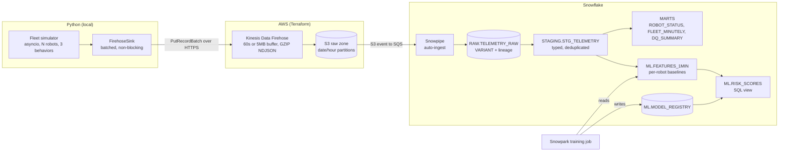

# FleetPulse

An end-to-end data engineering project on robotics telemetry: a Python fleet simulator streams into AWS, lands in Snowflake, and powers fleet analytics, silent-robot detection and a predictive-maintenance model that scores in plain SQL.

Built to show the full path a robotics company's data takes, with **no hardware**: a configurable simulator stands in for a warehouse AMR fleet, and everything downstream is real cloud infrastructure defined as code.

* [ ]  ****[](https://)************Architecture




| Layer         | What it does                                                                                                                                                                                                                                                                       |
| --------------- | ------------------------------------------------------------------------------------------------------------------------------------------------------------------------------------------------------------------------------------------------------------------------------------ |
| **Python**    | Simulates robots (battery, motor current and temperature, wear, faults). Three fleet behaviors: all publishing; a percentage split of continuous / random / abrupt-stop robots; random on/off. Fleet size, parameters and behavior can change at runtime through a controller API. |
| **AWS**       | Firehose buffers and writes GZIP newline-delimited JSON to S3, partitioned by date and hour. IAM roles, bucket policy, lifecycle rule and logging are all Terraform.                                                                                                               |
| **Snowflake** | Snowpipe loads raw JSON. Dynamic tables type and deduplicate it, build fleet marts, detect silent robots, and compute ML features. A resource monitor caps credits.                                                                                                                |
| **ML**        | Logistic regression trained with Snowpark, registered in a table, and scored by a SQL view (no Python runtime needed at query time).                                                                                                                                               |

## Results

Dataset: 7 simulator runs, about 1.2 million records. Six 2-hour runs of 30 robots (27 robots wear out and trip an overtemp fault) and one 10-minute mixed-fleet run.


| Check                             | Result                                                                                                                    |
| ----------------------------------- | --------------------------------------------------------------------------------------------------------------------------- |
| Ingestion                         | 0 dropped records and 0 retries across all runs; records sent equal records published                                     |
| Silent-robot detection            | Mixed-fleet run of 20 robots: the 2 abrupt-stop robots were flagged, silent for 458 and 513 event-seconds                 |
| Failure warning (in Snowflake)    | 27 of 27 failing robots alerted before the fault, **12 to 27 minutes ahead, median about 20**                             |
| False alarms                      | 2 of 153 healthy robots, both running at 84 °C, one degree under the trip point                                          |
| Model vs a fixed temperature rule | Parity. At 2 false-alarm robots: model 19.8 min median warning, rule (temp >= 65 °C) 21.8 min, rule (>= 70 °C) 14.8 min |

Evaluation is leave-one-run-out (every run is scored by a model that never saw it). AUC 0.997, average precision 0.86.

**Honest reading:** on this synthetic data, the learned model does not beat a well-tuned temperature threshold. What the project demonstrates is the pipeline, the evaluation discipline, and the failure modes found along the way (see `docs/DESIGN_TRADEOFFS.md`).

## Repository layout

```
src/fleetpulse/     simulator: robot physics, behaviors, controller, sinks, CLI
analytics/          Snowpark session, training, pure-pandas model code
infra/aws/          Terraform: S3, Firehose, IAM, CloudWatch, Snowflake trust and notifications
snowflake/          numbered SQL scripts 01 to 10 (+ 99 pause/resume)
configs/            default fleet config, degradation scenarios
scripts/            scenario generator
tests/              21 tests (behaviors, robot physics, controller, Firehose sink, model)
docs/               design tradeoffs, runbook
```

## Quick start

```bash
python3.11 -m venv env && source env/bin/activate
pip install -e ".[dev,aws,analytics]"
python -m pytest -q

# 1) Simulator only, no cloud
fleetpulse behaviors
fleetpulse run -n 20 -b mixed_fleet -d 600 -t 60 -s jsonl -o data/demo.jsonl
```

Full cloud build and teardown steps are in `docs/runbook.md`.

## Cost

[Fill in from AWS Billing and Snowflake usage after the final run.] Controls used: a $10 AWS budget alert, a 5-credit Snowflake resource monitor, XS warehouse with 60-second auto-suspend, 14-day S3 lifecycle, dynamic-table lag set to 5 minutes.

## Not built / roadmap

- Live dashboard (fleet control API plus pipeline view). The controller API it would wrap exists and is tested.
- EventBridge and Lambda scheduler for periodic data-quality runs. Not needed for ingestion, since Snowpipe and dynamic tables handle that.
- Streaming ingestion path with Snowpipe Streaming for sub-minute latency (compared in the tradeoffs doc, not implemented).

## Limitations

Synthetic data with simple physics; only 27 failure events; per-robot self-baselining partly hides very fast wear (the baseline period can already include early degradation).
